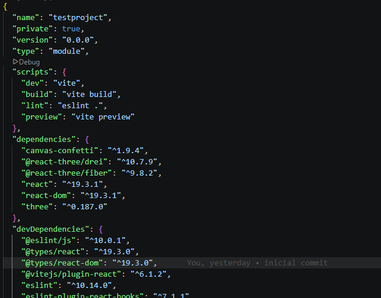
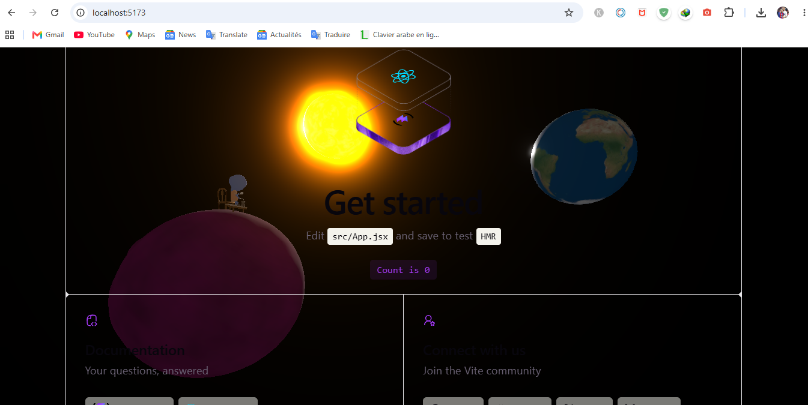

# Proyecto React con Vite

## Ramas del proyecto
- master
- react-confetti
- canvas-confetti
- three

## Capturas

### React Confetti

### Dependencias 

### Canvas Confetti

### Escena 3D

## Pregunta

Si la carpeta node_modules/ está excluida,
¿borrar una dependencia hace alguna acción sobre el repositorio?

Sí. Aunque node_modules/ esté excluida del repositorio,
al eliminar una dependencia con npm uninstall se modifican
package.json y package-lock.json.

Estos cambios se registran en Git mediante un commit.

## Web desplegada
https://yassineelmir10.github.io/myproject-deploy/
 

# React + Vite

This template provides a minimal setup to get React working in Vite with HMR and some ESLint rules.

Currently, two official plugins are available:

- [@vitejs/plugin-react](https://github.com/vitejs/vite-plugin-react/blob/main/packages/plugin-react) uses [Oxc](https://oxc.rs)
- [@vitejs/plugin-react-swc](https://github.com/vitejs/vite-plugin-react/blob/main/packages/plugin-react-swc) uses [SWC](https://swc.rs/)

## React Compiler

The React Compiler is not enabled on this template because of its impact on dev & build performances. To add it, see [this documentation](https://react.dev/learn/react-compiler/installation).

## Expanding the ESLint configuration

If you are developing a production application, we recommend using TypeScript with type-aware lint rules enabled. Check out the [TS template](https://github.com/vitejs/vite/tree/main/packages/create-vite/template-react-ts) for information on how to integrate TypeScript and [`typescript-eslint`](https://typescript-eslint.io) in your project.
